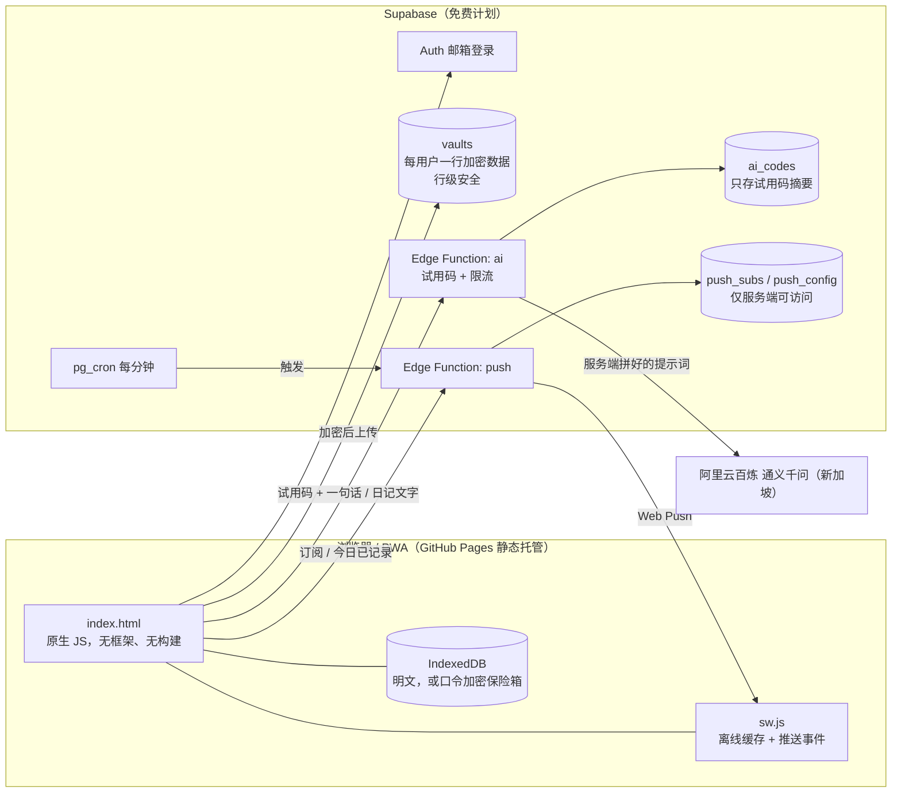

# 晴一日记 · 情绪日记与自我关怀

[](https://github.com/cjy20040604-hub/mood-diary/actions/workflows/test.yml)

**在线体验：** <https://cjy20040604-hub.github.io/mood-diary/>

手机浏览器打开即可使用，也可以添加到主屏幕当 App 用。

一句话：花一分钟记下此刻的心情，看清是什么在消耗你，再用冥想、白噪音、运动或想法整理把自己接住。

---

## 1. 为什么做这个

| 用户的处境 | 现有方案的缺口 | 晴一日记怎么做 |
|---|---|---|
| 学业、职场、社交压力下情绪频繁起伏，但没有记录习惯 | 日记类应用要写很多字，记两天就放弃 | 选一个表情就算完成，情绪、触发因素、备注都可以跳过；也可以只说一句话，由系统预填表单 |
| 知道“最近不太好”，说不出是被什么拖垮 | 只有心情曲线，没有归因 | 触发因素排行、周报，直接指出“哪件事、哪一天、和睡眠的关系” |
| 情绪上来时不知道该做什么，咨询又贵又难约 | 冥想类应用要注册、要付费 | 按当下情绪推荐 1 个冥想、1 种声音、1 个动作，点开就做，免费、无需注册 |
| 担心日记泄露，不敢写真话 | 云端日记要求账号、数据明文存储 | 默认只存在本机；可加口令加密；云同步端到端加密，服务器上只有密文 |

**产品原则**：门槛低、不说教、不制造焦虑、不做操纵式通知、数据归用户。

> 这不是医疗产品，不做诊断。识别到可能涉及自我伤害的内容时，会立即给出求助方式，并暂停 AI 功能。
> 心理援助热线 12356；希望 24 热线 400-161-9995；有立即危险时拨打 120 / 110。

## 2. 功能总览

### 今日 · 记录
- **一句话记录**：输入“组会被点名，脑子一片空白”这样一句话，系统预填心情、情绪、原因和睡眠，用户确认后才保存。流程固定为：危机检查 → 识别 → 风险判断 → 校验 → 用户确认，模型只负责“识别”这一步。填写试用码或自己的模型接口后用 AI 识别，否则用本机规则，不联网。设计取舍、评测集和结果见 [eval/README.md](eval/README.md)
- **AI 试用码**：试用者输入试用码即可使用 AI，不用自己申请模型密钥。试用码不公开，由试用计划私下发放；没有试用码的访客可以在设置页点一下，跳到「意见反馈」留下联系方式申请。请求经服务端函数转发到通义千问，服务端不保存文字，每台设备每天最多 30 次
- **保存日记时留意危险信号（可选，默认关闭）**：开启后，日记备注和想法整理保存时如果关键词没有命中，再请 AI 判断一次；判断有风险就给出求助方式并标记这条记录。检查在保存之后进行，不拖慢保存；出错不打扰用户
- 5 档心情 + 10 种具体情绪（分“不太好 / 还不错”两组）+ 原因 + 备注
- **原因跟着情绪走**：选了负面情绪，问“是什么让你有这种感受”（学业、睡眠不足、自我比较等 9 类压力来源）；选了正面情绪，问“是什么让你感觉不错”（完成了一件事、运动/户外、和朋友家人在一起等 9 类）；两种都选时两组都显示，切换后被隐藏的那组选择会自动清掉
- 写作提示跟着心情变化：心情低时问“此刻身体哪里最紧？”，心情好时问“是什么让今天变好了一点？”
- 保存后立刻给出一个对应情绪的小练习，闭环到“疗愈”
- **首次引导**：第一次打开时可直接体验“1 分钟呼吸”；记录不足 3 条时提示“再记几条就能看到第一份发现”
- 历史记录：按心情筛选、全文搜索、**编辑**（保留原时间，标注“已修改”）、二次确认删除
- **自定义标签**：两组原因各可添加最多 12 个自己的标签；删掉标签不影响过去的记录
- **睡眠时长（可选）**：单选“不到 5 小时”到“8 小时以上”；样本够时，周报对比睡得少和睡得够的日子
- **往日今天**：一周前、一个月前、三个月前、一年前的今天你写了什么
- **成就**：首次记录、连续 3 / 7 / 30 天、累计 20 条、完成 5 次练习、整理过想法、情绪觉察 30 次（只统计真实记录，不含示例数据）
- **危机识别**：日记和想法整理里出现可能涉及自我伤害的说法时，立刻弹出求助方式（热线可直接拨打），之后 7 天内在首页持续提示；同时排除“笑死”“累死了”“想死你了”“跳楼价”等日常说法
- 连续几天心情偏低时，出现温和的提醒和求助渠道；顶部和页脚随时有“需要帮助”入口

### 洞察 · 看清自己
- **情绪周报**（本地规则生成，不上传任何数据）：和上周对比、相对轻松 / 吃力的一天、情绪构成、可能拉低心情的触发因素、睡眠线索、过去 8 周的低谷日、小建议和直达练习的入口；可复制
- **不过度下结论**：少于 3 条记录不给发现；每项发现都有最小样本要求（如睡眠对比两组各至少 2 条且差值至少 0.8），措辞用“可能”，样本少时会注明，并说明“不是诊断”
- **AI 个性化复盘（可选，需单独同意）**：只使用用户自己填写的 OpenAI 兼容接口，没填写时不显示按钮、不发任何请求；本周有危机相关内容时不发送；提示词要求不诊断、不给治疗建议、样本少时不下结论
- **哪些练习对你有用**：按练习前后评分的平均变化排序
- 近 14 天情绪曲线、最近 5 周日历热力图、全年像素图
- 压力来源排行、**让你变好的事**（近 30 天）、近 30 天情绪构成

### 疗愈 · 接住自己
- **白噪音 / 氛围音**：雨声、海浪、风声、夜晚氛围、白噪音，在浏览器里生成为首尾无缝的循环音频，用系统播放器播放，锁屏或切到其他应用后仍继续，可在系统媒体控制里暂停；可调音量、定时关闭、渐入渐出
- **引导冥想**：1 分钟呼吸、4-7-8 呼吸、身体扫描、5-4-3-2-1 着陆、自我慈悲；逐步倒计时，可开关语音朗读和背景音，可跳过
- **练习前后评分**：开始前、结束后各点一次心情，显示“比开始前好了几档”；计时按时间戳计算，切到后台不漂移
- **按效果推荐**：某个练习做过 2 次以上且平均让心情变好，推荐时优先选它，并写明依据（如“你做过 3 次，平均让心情好了 1.3 档”）
- **动一动**：颈肩放松、原地踏步、桌前拉伸
- **想法整理（认知行为练习）**：情境 → 自动想法 → 难受程度 → 思维陷阱 → 更平衡的想法 → 重新评分，并统计平均降低多少
- 按最近一次的情绪（紧绷 / 低落 / 疲惫 / 平稳）推荐练习

### 设置 · 账号、提醒与数据
- **安装为 App**：PWA，离线可用
- **提醒**（三种可叠加）：应用内提示条；**服务器推送**（关闭网页也能收到，可选“时间窗内随机一次”，今天已记录则不再推送）；写入手机日历的每日重复提醒（.ics）
- **本机加密**：设置口令后，记录、令牌、密钥都以 AES-GCM 加密存储，每次打开需解锁
- **云端账号与同步**：邮箱注册，多设备同步，端到端加密
- **恢复码**：云端数据用随机数据密钥加密，数据密钥同时由“云端加密口令”和“恢复码”保护；忘记口令可用恢复码重设，也可重新生成恢复码（旧码立即失效）；旧格式数据在下次同步时自动升级
- **忘记账号密码**：发送重置邮件，从邮件链接回来后设置新密码（需配置发信服务后对所有用户可用，见“已知限制”）
- 进阶：GitHub 私密 Gist 同步（不想注册账号时使用）
- 导出 / 导入 JSON 备份，清除示例数据
- **我的使用情况**：近 7 天的记录、活跃天数、练习与练习效果，只在本机计算
- **改进计划（自愿加入）**：每天最多上报一次匿名汇总数字，设置页原样展示将要上报的内容；可随时退出并删除服务器上的数据
- **意见反馈**：文字反馈，联系方式可选
- **删除我的全部数据**：一次删除本机数据、云端账号与云端数据、推送订阅（以及填写了令牌时的 Gist 备份），需要输入“删除”确认；删除即撤回同意

### 知情同意
- 首次使用前需阅读并同意[《隐私政策与使用条款》](privacy.html)，并确认年龄（未满 14 周岁需监护人同意）
- 云同步、Gist 同步、服务器推送、AI 功能四个会把数据发出设备的功能，各自需要单独勾选同意，并写明数据存到哪里（含跨境说明）

## 3. 参考与取舍

调研了 GitHub 上高星的同类开源项目（依据各仓库公开简介，未运行其应用）：

| 项目 | Star | 借鉴 |
|---|---|---|
| Flaque/quirk（认知行为疗法 App） | 2.3k | 想法整理的结构；录入要快、字段可跳过；不做操纵式通知 |
| Demizo/Daily_You（日记） | 1.3k | 随机时间的每日提醒；离线优先；备份与导入导出 |
| journiv（自托管日记） | 1.2k | 提示式日记、搜索、数据分析 |
| GitJournal | 4.2k | 用自己的 Git 账号做存储的同步思路，对应这里的 Gist 同步 |
| Medito（冥想） | 1.3k | 免费、无需注册即可使用 |

主动不做的事：不做社交 / 排行、不做打卡惩罚、不收集用户身份信息、不做连续天数焦虑营销。

## 4. 技术架构



- **前端**：`index.html` 加共享核心 `core.js`，原生 JavaScript，没有框架和构建步骤，打开即用。`core.js` 放标签、危机识别和一句话记录的识别与校验逻辑，页面和评测脚本加载同一份
- **离线**：`sw.js` 对页面做“网络优先、断网用缓存”，其余资源先读缓存再后台更新
- **存储**：记录存放在 IndexedDB（不可用时退回 localStorage），带数据版本号；从旧版升级时先写入、逐项读回核对一致后才删除旧数据，核对失败则继续用旧存储；所有写入排队执行，数据读完之前不允许写入
- **加密**：口令经 PBKDF2（25 万次）派生密钥，AES-GCM 加密；本机保险箱和云端同步都用同一套思路
- **云同步**：数据在本机加密成一个文本块，按用户存进 `vaults` 表；多设备按记录 id 合并，同一条记录保留最后修改的版本；删除用“墓碑”记录同步，删除晚于修改才生效，墓碑保留 180 天
- **多标签页**：一个标签页写入后，通过 BroadcastChannel 通知其他标签页重新读入数据
- **无障碍**：颜色对比度达到 WCAG AA（浅色与深色两套主题）；标签页支持方向键、Home、End；弹窗内焦点循环；每次提交由 axe 自动检查
- **字体**：使用系统中文字体，不再从 Google 加载，国内访问更稳定
- **推送**：浏览器订阅 Web Push，订阅信息存进 `push_subs`；`pg_cron` 每分钟调用边缘函数，函数按每个订阅的本地时间判断是否到点，发送后当天不再重复，错过 3 小时以上不补发，失效订阅自动清理
- **AI 功能**：两种方式。试用码走服务端函数 `ai`：它不是通用的模型代理，提示词在服务端拼好，客户端只能传文字和标签；试用码只存摘要；按设备 30 次、IP 60 次、试用码 150 次、全站 300 次每天限流，计数出错时拒绝（宁可暂时不可用，不让额度失控）；模型密钥只在 Supabase 的函数密钥里。自己的接口：密钥只在内存中，或在启用本机加密后加密保存，请求从浏览器直接发往该接口。两种方式用的是同一份提示词，测试会核对服务端和 `core.js` 生成的提示词完全相同
- **一句话记录**：一次模型调用，温度 0，要求只输出 JSON，只能从已有标签里选。返回结果经过校验，不在标签表里的一律丢弃；接口出错、超时（10 秒）或格式不对时退回本机规则。确认时改了几处记在本机（`ql.fix`），用来计算采纳率
- **评测**：`eval/cases.json` 56 条用例（含 10 条危机表达和 5 条口头禅），`eval/run-eval.mjs` 计算精确率、召回率、危机拦截率、延迟，并对照上线门槛给出结论；CI 每次运行安全底线检查。结果：规则基线漏掉全部隐晦危机表达、情绪召回 68%；AI（qwen-plus-character，提示词 v2）9 项门槛全部达标，详见 [eval/README.md](eval/README.md)

## 5. 隐私与安全

| 项目 | 做法 |
|---|---|
| 记录存放 | 默认只在本机浏览器；不上传，除非用户主动开启云同步 |
| 本机加密 | 口令加密整个数据集；连续输错 5 次开始限速；忘记口令只能清空本机数据 |
| 云端内容 | 服务器上只有密文，开发者和云服务商都读不到；忘记“云端加密口令”后无法恢复 |
| 数据库权限 | `vaults` 开启行级安全，用户只能读写自己的一行，匿名用户一律拒绝；推送相关两张表收回所有前端权限 |
| 密钥管理 | 推送私钥和定时任务密钥只在数据库配置表里，不在页面、不在本仓库 |
| 令牌与 API Key | 默认只在内存；启用本机加密后才加密落盘 |
| 推送内容 | 通知文案由服务器从固定几句里挑选，不含任何用户记录 |
| 接口防滥用 | 推送函数限制请求体积（4KB）、按 IP 摘要限流（总量 300 次/小时、订阅 10 次/小时、测试推送每个订阅 10 分钟 3 次）、订阅总量上限 5000；只存不可还原的摘要，每天清理 |
| 账号删除 | 服务端校验用户令牌后删除云端数据与账号 |
| 危机内容 | 本机识别，命中后给出求助方式；不会发送给 AI 服务。一句话记录先在本机检查，再发给模型；模型也判断风险，判断有风险时同样停止。日记的 AI 危险信号检查需要用户单独开启 |
| AI 试用 | 服务端不保存文字；试用码只存摘要；四层每日限流；可随时停用某个试用码 |
| 知情同意 | 首次使用总同意 + 每个联网功能单独同意；隐私政策见 [privacy.html](privacy.html) |
| 改进计划与反馈 | 两张表只能写入、不能读出；汇总数字只能通过服务端函数写入（校验日期、同一天只记一次）；退出时按本机随机标识删除；最长保存 12 个月，每天自动清理 |

## 6. 已知限制

- **邮箱确认已关闭**：Supabase 默认发信服务只发给团队成员，所以注册后直接可用。这意味着可以用不存在的邮箱注册。要做真正的邮箱验证和找回密码，需要配置自己的发信服务。
- **PIN / 口令只防“拿到设备的人”这一类风险**，不防已经被入侵的设备。
- **推送依赖浏览器**：iPhone 需要先「添加到主屏幕」；国内部分安卓浏览器没有推送通道。不可用时仍有应用内提示条和日历提醒。
- **AI 只对试用者开放**：试用码面向一轮 15–20 人的封闭试用，用的是免费额度。普通访客需要自备模型接口；没有开启 AI 时，一句话记录用本机规则：不乱填，但认不出隐含的表达（评测中情绪召回率 68%）。
- **AI 识别的评测结果偏乐观**：用阿里云百炼 `qwen-plus-character` 评测，提示词迭代一轮后 9 项上线门槛全部达标（危机 10/10、情绪召回 100%、心情偏差 ≤ 1 档 100%）。但提示词是看着这 56 条用例调的，还需要新用例复核；该模型偏角色扮演，只因免费额度可用。
- **找回账号密码依赖发信服务**：Supabase 默认发信服务只发给项目成员，普通用户需要配置自有发信服务（SMTP）后才能收到重置邮件。
- 推送与云同步的“真实设备端到端”需要使用者授权通知、注册账号后才能完整走通。
- 周报和推荐是规则生成，不是临床判断。
- **危机识别默认以关键词为主**，会漏掉隐晦的表达：日记长度的评测里关键词只识别出 2/12，加上 AI 后 12/12。AI 这一层需要开启 AI 并单独同意，所以没开启的用户仍只有关键词保护。关键词也会误报转述新闻、影视剧的文字。它只是兜底提示，不能代替人工或专业判断。
- **隐私政策尚未经过法律专业人士审阅**，正式运营前需要审阅，并完成相应的备案与评估。
- 冥想和认知行为练习的文案尚未经过心理专业人士审核。
- **意见反馈没有服务端限流**：前端限制 30 秒一次，但接口本身可被批量写入；正式运营前需要加验证码或服务端限流。
- **代码仍是一个大文件**：`index.html` 约 11 万字符，尚未拆分模块、引入 TypeScript 和构建步骤；目前靠 86 项端到端测试兜底。

## 7. 测试情况

仓库里有一套 Playwright 端到端测试（`app.spec.mjs`），每次推送到 `main` 都会在 GitHub Actions 上自动运行（见顶部徽章）。共 86 项，覆盖：

- AI 试用码：没有试用码的访客可从设置页一键跳到意见反馈申请；经服务端调用且请求里没有提示词、无效试用码、次数用完时退回规则；日记危险信号检查默认关闭不发送、开启后识别隐晦表达并给出求助方式、关键词已命中不再发送、AI 说没风险或出错不打扰、想法整理同样检查、旧版同意不沿用；服务端与 core.js 提示词一致
- 一句话记录：规则预填且不联网、确认时记下改动次数、撤销预填、危机表达不识别也不发送、AI 只能选已有标签、AI 判断有风险时停止并标记、接口出错或格式不对时退回规则、旧版同意不沿用、看不出心情时不乱填

- 首次使用的知情同意、隐私政策页面、联网功能的单独同意
- 记录、筛选、搜索、二次确认删除、导出与导入
- 情绪与原因的对应：正面情绪只问正面来源、负面情绪只问压力来源、切换后不残留矛盾选择、写作提示跟随心情、示例数据自洽
- 危机识别：规则的命中与不误报、记录和想法整理中触发求助、首页持续提示、“需要帮助”入口
- AI 复盘：有危机内容时不发送任何请求；正常时请求里带有安全约束
- 周报：少于 3 条不下结论、单条睡眠记录不下“相关”结论、证据足够时用“可能”并注明样本少
- 本机加密（磁盘无明文、错误口令、解锁）、删除全部数据（含删除云端账号的请求）、“仅删除云端数据”保留账号、接口限流提示
- 白噪音播放与停止、引导练习完成后记入日志、手机宽度无横向滚动
- 练习前后评分、按效果推荐、首次引导、循环音频首尾衔接与定时停止、引导在页面被挂起后能追上正确步骤
- 存储：旧数据迁移到 IndexedDB 并核对、加密保险箱迁移后可解锁、无 IndexedDB 时退回、数据读完之前不写入
- AI 复盘：没填接口时不显示按钮且不发请求、填写并同意后才发送、旧版同意不沿用
- 恢复码：首次同步生成、忘记口令后重设、重新生成后旧码失效、旧格式自动升级；找回账号密码
- 无障碍：浅色与深色主题下各页面和弹窗无 WCAG AA 违规（axe）、标签页键盘操作、弹窗焦点循环
- 编辑记录、按修改时间合并、墓碑清理、两个标签页之间同步
- 自定义标签（添加、重复、上限、删除）、睡眠时长与周报对比、编辑时回填
- 改进计划：预览不含日记内容、加入后上报且同一天不重复、未加入不上报、退出删除；意见反馈与频率限制；删除全部数据时一并删除改进计划数据

测试拦截了所有外部网络，不会触达线上服务。为了确认测试真能发现问题，做过“故意改坏”的检查：关闭危机识别、取消样本量门槛后，有 5 项测试按预期失败；在一句话记录里分别删掉危机检查、模型风险判断、标签校验、失败退回，每一次都有测试失败；让日记危险信号检查忽略“默认关闭”、或改动服务端提示词的一个字，也都有测试失败。

本地运行：

```bash
npm install
npx playwright install chromium
npm test
```

**没有自动验证的**：真实邮箱注册与登录、真实设备收到推送通知、AI 复盘接真实模型、网页端接真实模型（评测脚本已用真实模型跑过同一套提示词和校验，网页端用模拟接口测试；试用码通路在部署后手动验证过）、线上推送函数的限流效果。这些需要账号授权、通知授权或模型密钥，需要人工走一遍。

## 8. 仓库文件

| 文件 | 说明 |
|---|---|
| `index.html` | 整个应用 |
| `core.js` | 共享核心：标签、危机识别、一句话记录的规则识别、提示词与输出校验 |
| `eval/` | AI 评测：一句话记录用例 `cases.json`、日记危险信号用例 `risk-cases.json`、脚本 `run-eval.mjs`、报告 `report.md`（第一版提示词的报告 `report-ql-1.md`）、设计说明 `README.md` |
| `supabase-ai-function.ts` | AI 试用的边缘函数源码：试用码校验、限流、服务端拼提示词（不含任何密钥） |
| `sw.js` | Service Worker：离线、推送、通知点击 |
| `manifest.webmanifest`、`icon-192.png`、`icon-512.png` | PWA 安装信息与图标 |
| `supabase-schema.sql` | 数据库表与行级安全（不含任何密钥） |
| `supabase-push-function.ts` | 推送边缘函数源码：订阅、发送、限流、删除账号（不含任何密钥） |
| `privacy.html` | 隐私政策与使用条款 |
| `app.spec.mjs`、`playwright.config.mjs`、`test-server.mjs`、`package.json` | 端到端测试 |
| `.github/workflows/test.yml` | 每次提交自动运行测试 |
| `research-plan.md` | 第 4 周用户试用计划：假设、成功标准、招募、日程、指标查询语句、访谈提纲、危机预案、决策规则 |

## 9. 后续方向

- 配置自有发信服务，恢复邮箱确认与找回密码
- 英文界面与更多冥想内容（可录制真人音频）
- 周报接入更细的睡眠 / 运动数据
